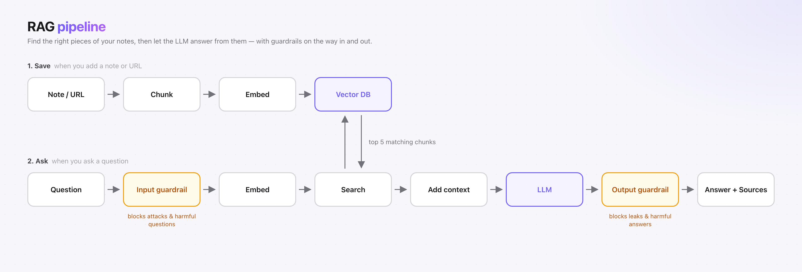
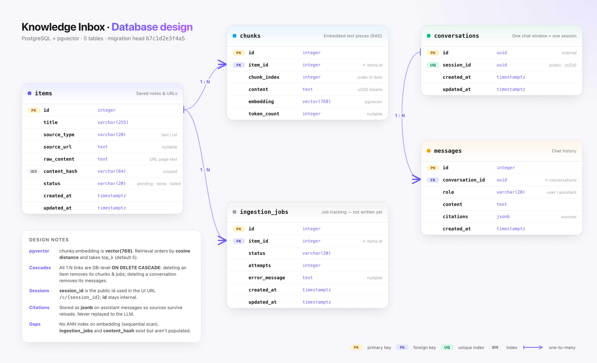
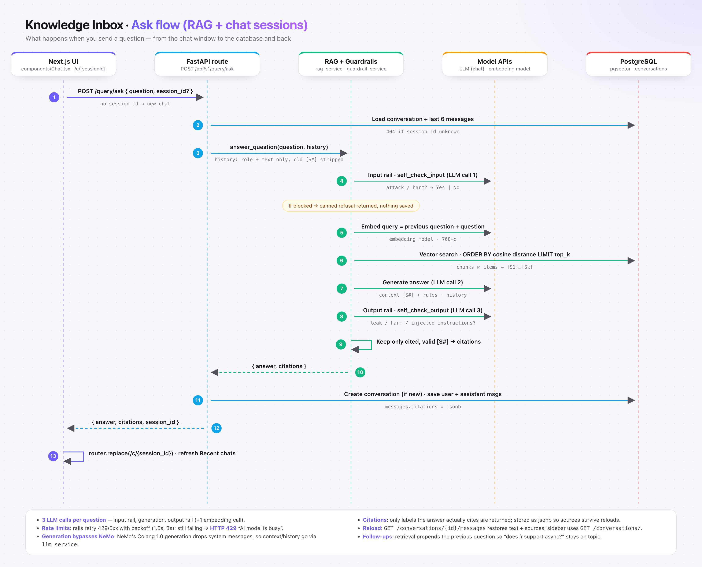
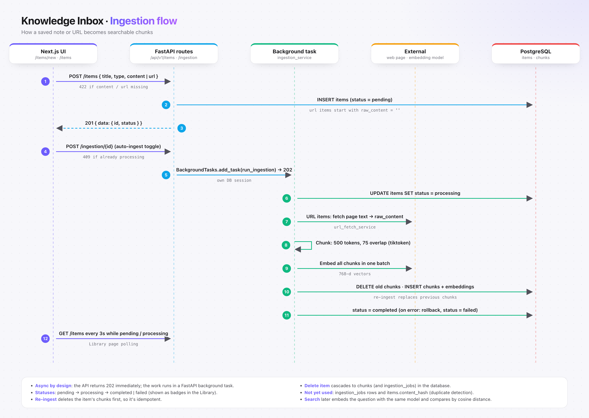

# Knowledge Inbox

Your personal AI knowledge assistant. Save notes and web links, then **ask questions in a chat** —
answers come only from what you saved, with **sources you can click**, and every question and answer is
checked by **guardrails**.

<!-- Screenshots -->
<!--  -->
<!--  -->

## Features

- **Save** text notes or URLs (page text is fetched automatically)
- **Ask** questions — RAG search over your notes, cited answers `[S1]`, source cards
- **Chat sessions** — each conversation has its own URL (`/c/<session_id>`), history and sources are kept
- **Guardrails** — blocks prompt injection, secret leaks and harmful content
- **Library** — search, filter, re-ingest and delete saved items

## Tech stack

| Layer | Technology |
|---|---|
| Frontend | Next.js 16 · React 19 · TypeScript · Tailwind CSS 4 |
| Backend | FastAPI · SQLAlchemy (async) · Alembic · Pydantic |
| Database | PostgreSQL 16 + **pgvector** (Docker) |
| AI | OpenAI-compatible LLM (z.ai GLM / LM Studio) · 768-d embeddings · tiktoken chunking |
| Safety | NVIDIA **NeMo Guardrails** (input + output rails) |
| Tooling | uv (Python) · npm · Docker Compose · Make |

## Run it — one command

**Needs:** Docker, [uv](https://docs.astral.sh/uv/), Node.js 20+

```bash
cp backend/.env.example backend/.env   # first time only — fill in your LLM / embedding settings
make dev
```

That's it. `make dev` starts the database, applies migrations, and runs both servers:

- App → http://localhost:3000
- API docs → http://localhost:8000/docs

**Ctrl+C** stops the app · `make docker-down` stops the database.

## How it works

### RAG pipeline



1. **Save** — a note or URL is split into chunks, each chunk is embedded, and stored in the vector DB.
2. **Ask** — the question passes the input guardrail, the top 5 matching chunks are found, the LLM answers
   from them, and the output guardrail checks the answer before you see it with its sources.

### Database design



`items` → `chunks` (text + `vector(768)` embeddings) for search · `conversations` → `messages` (with `citations`)
for chat history.

### Ask flow



What happens when you send a question — from the chat window through guardrails, vector search and the LLM,
to the saved conversation and back.

### Ingestion flow



How a saved note or URL becomes searchable — the API returns immediately and a background task fetches,
chunks, embeds and stores it, while the Library polls for the status.

Diagram sources live in [`docs/diagrams/`](docs/diagrams/build.py) — regenerate with `python3 docs/diagrams/build.py`.
