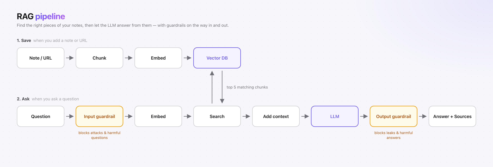
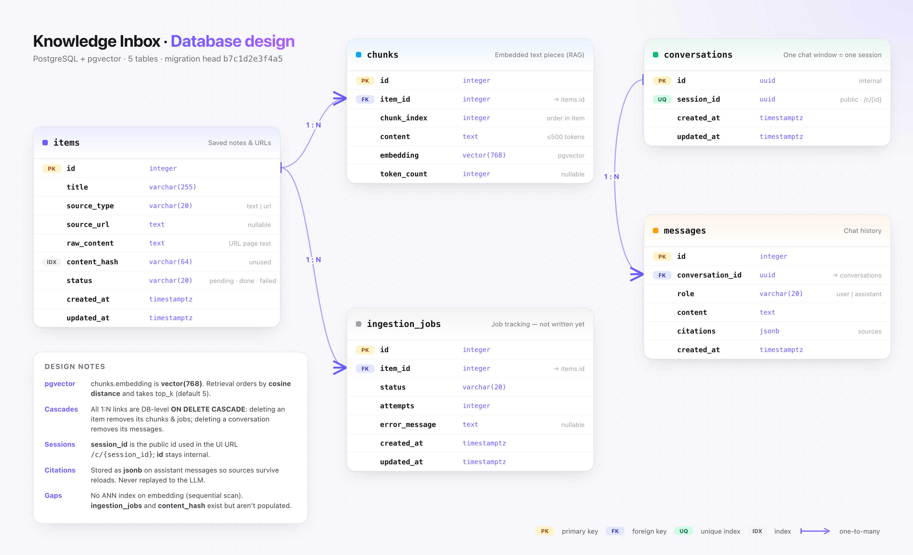
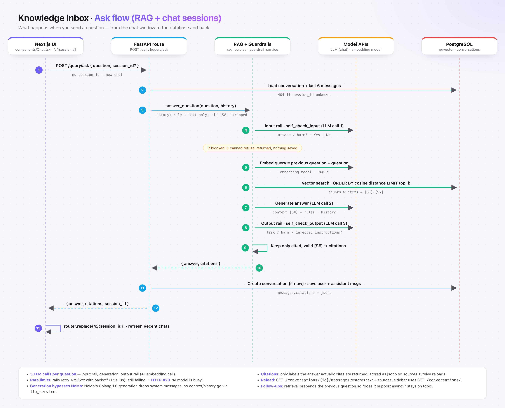
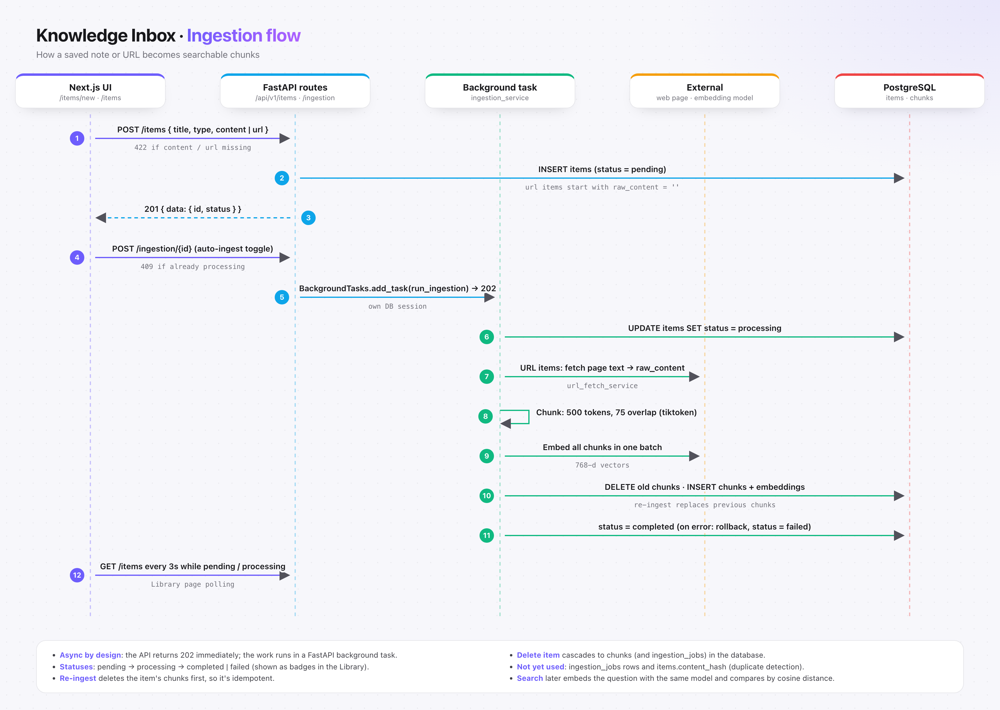

# Knowledge Inbox — Architecture docs

| Diagram | What it shows |
|---|---|
| [`rag-pipeline.png`](rag-pipeline.png) | **Start here** — the RAG pipeline in simple boxes: save, then ask |
| [`database-design.png`](database-design.png) | PostgreSQL + pgvector schema: 5 tables, keys, relations, cascades |
| [`ask-flow.png`](ask-flow.png) | A question from the chat window → guardrails → retrieval → LLM → saved conversation |
| [`ingestion-flow.png`](ingestion-flow.png) | A saved note / URL → background ingestion → chunks + embeddings |

## RAG pipeline



**RAG = Retrieval-Augmented Generation** — find the right pieces of your notes, then let the LLM answer from them.

1. **Save:** note / URL → split into chunks → embed → store in the vector DB.
2. **Ask:** question → **input guardrail** → embed → search the vector DB for the top 5 chunks → add them to the prompt → LLM → **output guardrail** → answer + sources.

**Guardrails** (NeMo Guardrails, each is one LLM "Yes / No" check):
- **Input guardrail** — blocks prompt injection, jailbreaks, requests for secrets, and harmful questions *before* anything is searched.
- **Output guardrail** — blocks answers that leak secrets, contain harmful content, or follow instructions hidden in a saved page.
- If either one blocks, the user gets a polite refusal and nothing is saved to the chat history.

## Database design



- **items** — saved notes and URLs. `status`: `pending → processing → completed | failed`.
- **chunks** — ≤500-token pieces of an item with a `vector(768)` embedding; searched by cosine distance.
- **conversations** — one per chat window. `session_id` is the public id used in the UI URL `/c/{session_id}`.
- **messages** — chat history; assistant messages keep their sources in `citations` (jsonb).
- **ingestion_jobs** — schema exists, not written by the code yet.
- All one-to-many links are `ON DELETE CASCADE` in the database.

## Ask flow



## Ingestion flow



## Updating the diagrams

The PNGs are generated from [`diagrams/build.py`](diagrams/build.py) (plain Python + headless Google Chrome, no packages to install):

```bash
python3 docs/diagrams/build.py
```

Edit the `TABLES`, `SAVE_ROW` / `ASK_ROW`, `ASK_STEPS` or `INGEST_STEPS` data in that file and re-run. The intermediate HTML files in `docs/diagrams/` can also be opened directly in a browser.
